## Summary

We model district-level soybean yield in Maharashtra as a function of June-September rainfall and season-mean temperature, using a balanced panel of 13 districts over 2000-2017 (234 district-years), district fixed effects and a common time trend. A quadratic model in rainfall and temperature is supported over a linear one under every inference method we pre-specified. With temperature held at each district's mean, a 100 mm rainfall deficit is associated with an estimated yield reduction of **10.0%** (95% interval 4.3% to 15.2%), about **117 kg/ha** (51 to 177 kg/ha), averaged over the 13 districts. The size of this estimate depends on the specification: the linear model gives 6.4% (interval including zero), and adding year fixed effects reduces it to 3.2% (interval including zero), because most rainfall variation in the panel is shared across districts within a year. All results are associations under the stated assumptions, not causal effects.

---

## 1. Assumptions

### 1.1 Problem and research question

Soybean in Maharashtra is a rainfed *kharif* crop sown with the onset of the south-west monsoon, so its yield is exposed to the amount and timing of monsoon rainfall and to temperature. We ask:

> How do monsoon rainfall, its timing, and temperature affect district-level soybean yields in Maharashtra, and is the relationship better represented by a linear or a quadratic model? What yield change is associated with a 100 mm rainfall deficit?

Objectives:

1. Build a district-year panel of soybean yield and district-level weather for Maharashtra, 2000-2017.
2. Estimate linear (M1) and quadratic (M2) panel regressions with district fixed effects.
3. Compare the two models with statistical tests, information criteria and held-out prediction.
4. Run numerical experiments: a 100 mm rainfall deficit and weak-monsoon scenarios (rainfall at 90% and 80% of normal).
5. Assess stability through residual diagnostics, leave-one-out checks and robustness runs.
6. State what can and cannot be inferred causally.

Every number reported here is generated by code in the project repository (see Appendix C), and the model specification and decision rules were written down before the final models were run (Appendix D).

### 1.2 Background and literature

Regressing yield on growing-season temperature and precipitation in a panel is a standard way to measure how weather affects crop yields. Lobell et al. (2011) fitted country-level panel models for maize, wheat, rice and soybean that include temperature, precipitation, their squares, country-specific intercepts and country-specific time trends, with bootstrap confidence intervals. They treat the results as a measure of the pace of climate change, not as predictions that include farmers' adaptation. Lobell and Field (2007) found that growing-season temperature and precipitation explain roughly 30% or more of year-to-year variation in global average yields of the six most widely grown crops. Our design follows this panel tradition but works at district level in one state, for one crop, with an explicit treatment of dependence between districts.

Schlenker and Roberts (2009) found strongly nonlinear temperature effects in US county data, with yields rising up to about 29 C for corn, 30 C for soybean and 32 C for cotton and falling steeply above those thresholds. This motivates a squared temperature term, although our season-mean temperature on a coarse grid is a much weaker measure of heat exposure than their data.

For India, Auffhammer et al. (2012) used state-level data for 1966-2002 and found that drought and extreme rainfall reduced rice yield in predominantly rainfed areas, with drought having the larger effect. Goswami et al. (2006) found rising frequency and magnitude of extreme rain events over central India in 1951-2000 with no significant trend in seasonal mean rainfall, which is one reason seasonal totals can hide changes within the season and motivates our timing variables.

The closest evidence is Maiti et al. (2026), who use district-level Indian yield data for 1990-2017 for eight *kharif* crops including soybean and cotton and report yield losses beyond an optimal seasonal rainfall threshold, comparable to the losses from equivalent deficits. Their effects are measured beyond a threshold, per 1% of seasonal rainfall, so their numbers are not comparable with our 100 mm deficit; we use their work only as qualitative support for a concave rainfall response. A companion paper (Maiti et al., 2024) reports a similar optimum for rice. Patil and Shende (2022) analyse soybean productivity in Akola district over 1991-2020, but their overall regression is not statistically significant (p = 0.30) and the only significant link is a simple correlation with rainfall (about 0.43, n = 30). We treat it as weak local evidence only.

The gap we address is a district-level, soybean-specific, nonlinear estimate for Maharashtra, with inference that allows for the fact that districts share weather.

### 1.3 Data sources and panel construction

**Yield data.** The ICRISAT District Level Database extract supplied for the project covers 26 Maharashtra districts, 2000-2017 (464 rows, no missing values). Column headers confirm the units: area in 1000 ha, production in 1000 tons, yield in kg/ha. Reported yield matches 1000 x production / area to within 0.1 kg/ha (rounding), so no conversion was needed. The database follows older district boundaries. There are 68 rows with zero soybean area (Bombay 14; Raigad, Ratnagiri and Thane 18 each); in each, production and yield are also zero. These were treated as "not grown" and dropped, not as zero yields.

**District selection.** We kept districts with at least 15 years in which soybean area was at least 20 thousand ha (counted over 2000-2017). This rule was derived from the data and selects 13 districts (Table 1). Four further districts (Aurangabad, Ahmednagar, Nasik, Satara) each had 14 qualifying years and are used only in a robustness run. Six district-years with area below 20 thousand ha in selected districts (Beed 2000-2002, Nanded 2000, Osmanabad 2000-2001) are kept, because the rule selects districts, not rows, and are tested in robustness runs.

**Table 1. The 13 districts, 2000-2017: mean soybean area, mean yield and IMD rainfall subdivision.**

| District | Subdivision | Mean area (kha) | Mean yield (kg/ha) |
|---|---|---|---|
| Akola | Vidarbha | 325.4 | 1078 |
| Amarawati | Vidarbha | 267.7 | 1014 |
| Beed | Marathwada | 70.6 | 955 |
| Buldhana | Vidarbha | 219.6 | 1185 |
| Chandrapur | Vidarbha | 143.5 | 946 |
| Kolhapur | Madhya Maharashtra | 58.3 | 2041 |
| Nagpur | Vidarbha | 230.4 | 920 |
| Nanded | Marathwada | 162.3 | 960 |
| Osmanabad | Marathwada | 266.7 | 1048 |
| Parbhani | Marathwada | 226.7 | 1120 |
| Sangli | Madhya Maharashtra | 58.8 | 1802 |
| Wardha | Vidarbha | 172.6 | 1006 |
| Yeotmal | Vidarbha | 217.8 | 982 |

**Weather data.** District-level weather was built from India Meteorological Department (IMD) gridded daily data, downloaded on 19 October 2026 with the `imdlib` Python package (version 0.3.1): rainfall on a 0.25 degree grid (Pai et al., 2014) and daily maximum and minimum temperature on a 1.0 degree grid, for 2000-2017 (54 files, with exact size checks and checksums recorded in the data-source register). District boundaries are the 2011 Census district layer from the DataMeet maps repository (pinned to a fixed commit; licence CC BY 2.5 India), which has 35 Maharashtra districts.

**Boundary reconciliation.** Because ICRISAT uses older boundaries, each ICRISAT district is the union of the 2011 districts carved from it. For the 13 panel districts this affects four: Akola = Akola + Washim, Parbhani = Parbhani + Hingoli, Osmanabad = Osmanabad + Latur, Chandrapur = Chandrapur + Gadchiroli (Appendix B). The Akola-Washim link (Washim was carved from Akola on 1 July 1998) was checked against two official sources (the Central Ground Water Board district document for Washim and the Akola district website). The other pairs come from Maharashtra government district-history pages compiled during the project and were not independently re-verified. Two limitations remain: Partur taluka went from Parbhani to Jalna in 1981 and Jalna is kept wholly in Aurangabad, so old Parbhani lacks Partur; and district renames (Dharashiv, Chhatrapati Sambhajinagar, Ahilyanagar) were treated as name changes only.

**Spatial aggregation.** For each old district and day, the value is the area-weighted mean over the grid cells that overlap the district, with weights equal to the overlap area (equal-area projection). Rainfall uses 17 to 57 cells per old district (Bombay 5). Temperature cells are larger than many districts: each district overlaps only 2 to 8 one-degree cells, and 7 old districts contain no cell centre, which is why a fractional-overlap method was used. No missing grid value occurred in any overlapping cell on any day.

**Validation.** Before modelling, gridded Jun-Sep rainfall was compared with IMD's own subdivision totals for 2000-2015. Correlations were 0.97 for Vidarbha, 0.96 for Marathwada and 0.88 for Madhya Maharashtra, with mean ratios of 1.03, 1.02 and 0.93 (Figure 1). Compared with district long-period normals, only Kolhapur among the panel districts differed by more than 25% (gridded 1102 mm against a normal of 1738 mm). Seasonal temperature ranged from 25.1 to 29.3 C across district-years, with the warmest districts in Vidarbha (Yeotmal, Chandrapur, Wardha) and the coolest being Sangli and Kolhapur.

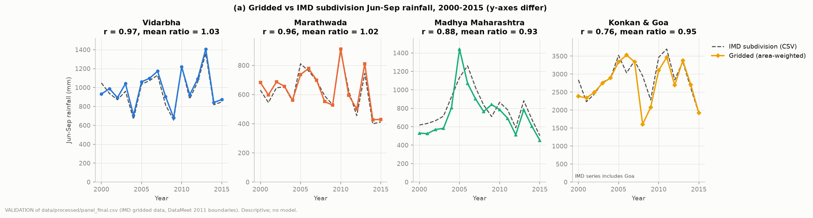

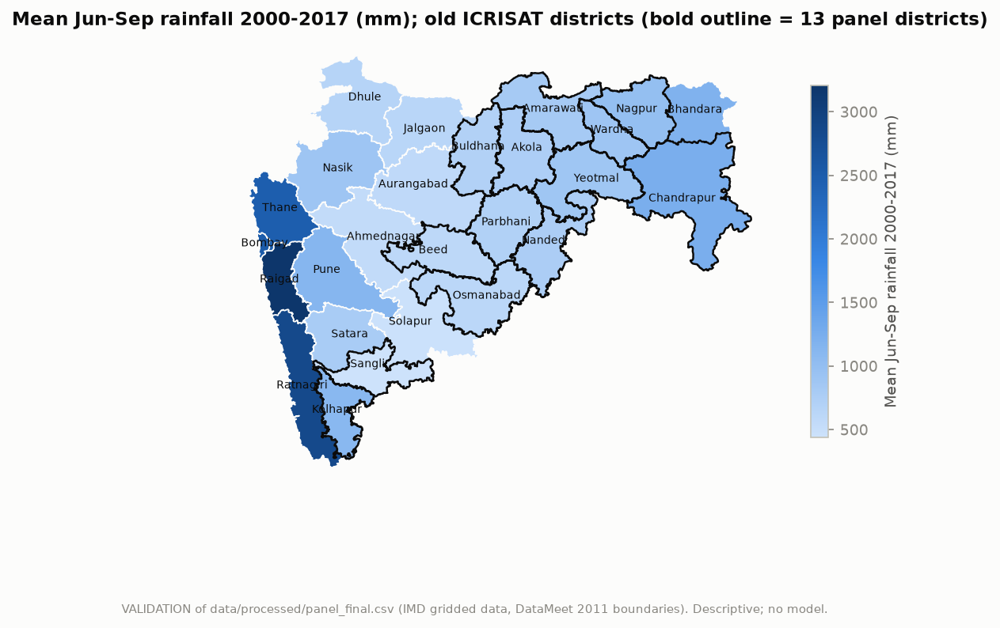

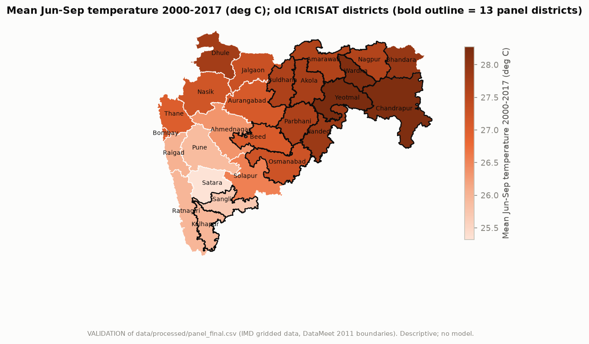

**Known data-quality problems.** The gridded rainfall product has apparent artefacts along the Western Ghats. In 2008 the gridded totals for Ratnagiri and Raigad were about 0.54 times IMD's subdivision total, and for Pune in 2005 about 1.27 times, with 19 cell-days above 300 mm. We checked the raw files: there are no missing-value codes, negative values or values above 1000 mm/day in any cell used, so these are properties of the IMD gridded product, not processing errors. Pune, Ratnagiri and Raigad are not in the panel, but Kolhapur and Sangli lie in the same zone, so a robustness run drops them (Section 4.3). A pre-specified screen (|robust z| greater than 3 within district) flags three district-years, all in Buldhana (2002, 2006, 2013); their gridded totals match IMD's subdivision totals (ratio 1.02 to 1.03), so they appear to be genuinely wet years. The screen did not flag any Ghats district-year; it was applied as written and not redefined after seeing this.

A further data limitation is that, across the 13 districts, rainfall is highly shared: the mean pairwise correlation of district rainfall is 0.54, and the effective number of independent rainfall signals (participation ratio) is **2.56**, with five components needed for 90% of the variance. This is more than the three series that subdivision-level rainfall would give, but far fewer than 13, and it shapes the inference methods in Section 2.1.

### 1.4 Variables

Season is 1 June to 30 September (122 days). For district *d* and year *t*:

- $\ln Y_{dt}$: natural log of soybean yield (kg/ha).
- $R_{dt}$ (R_season): total season rainfall (mm), the sum of daily district-mean rainfall. $R_{early}$ is 1 Jun-31 Jul and $R_{late}$ is 1 Aug-30 Sep, used to represent timing.
- $T_{dt}$ (T_season): mean over the season of the daily mean of Tmax and Tmin (C).
- dry_spell_max: longest run of consecutive days with district-mean rainfall below 2.5 mm within the season.
- $t$: trend, year minus 2000.
- Centred variables: $Rc = (R - \bar R)/100$ (unit: 100 mm) and $Tc = T - \bar T$ (C), where the grand means over the panel are $\bar R = 810.4$ mm and $\bar T = 27.45$ C. Centring makes the linear coefficients interpretable at the panel mean.

**Table 2. Summary statistics of model variables (234 district-years).**

| Variable | Mean | Std | Min | Median | Max |
|---|---|---|---|---|---|
| ln_yield | 6.922 | 0.555 | 5.100 | 7.047 | 7.933 |
| yield (kg/ha) | 1158.2 | 542.8 | 164.0 | 1149.3 | 2787.0 |
| R_season (mm) | 810.4 | 281.9 | 198.4 | 787.2 | 1855.5 |
| R_early (mm) | 424.1 | 188.0 | 91.1 | 391.6 | 1251.6 |
| R_late (mm) | 386.3 | 136.6 | 105.0 | 371.8 | 946.5 |
| T_season (C) | 27.447 | 0.904 | 25.062 | 27.623 | 29.270 |
| dry_spell_max (days) | 13.7 | 5.1 | 5 | 13 | 36 |
| area (kha) | 186.2 | 118.0 | 3.3 | 176.1 | 529.6 |

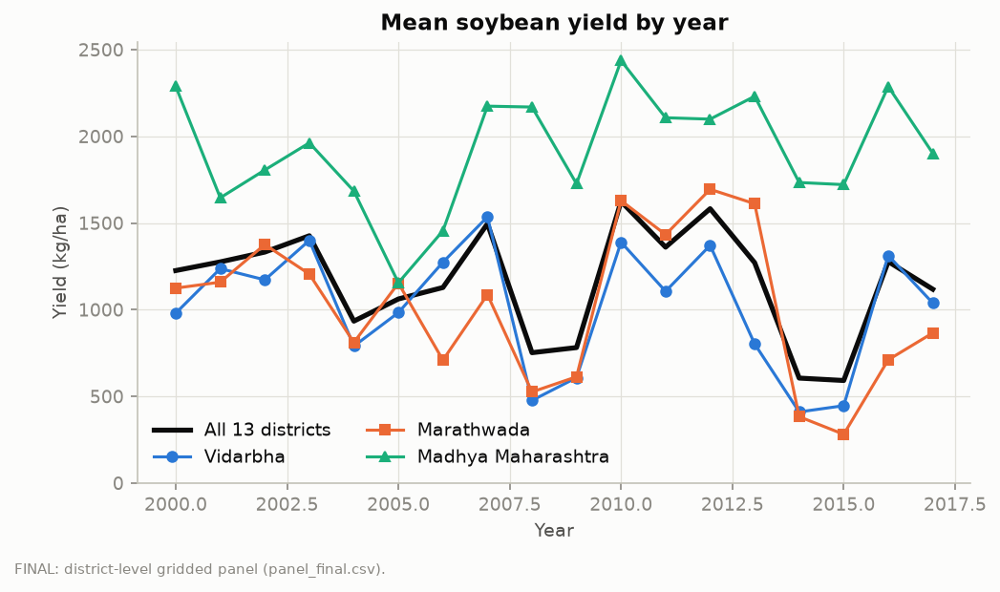

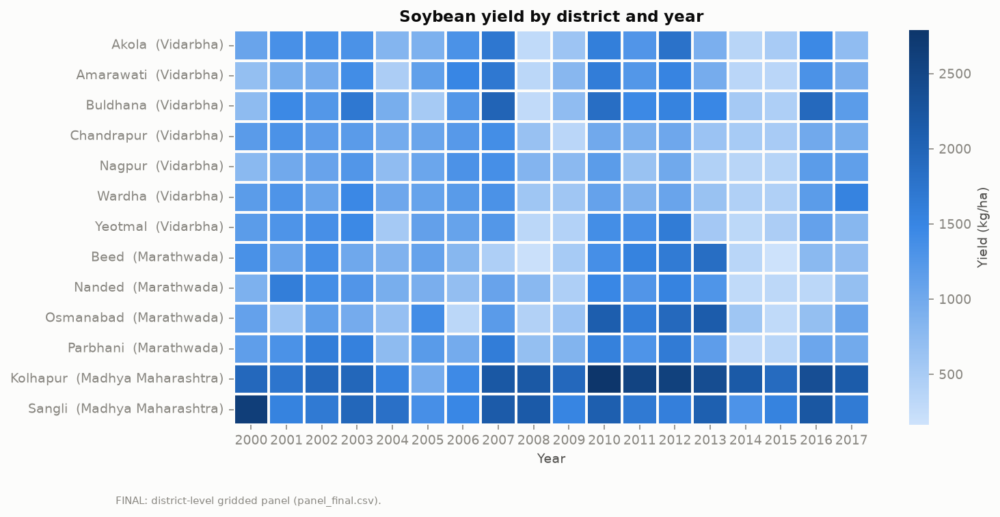

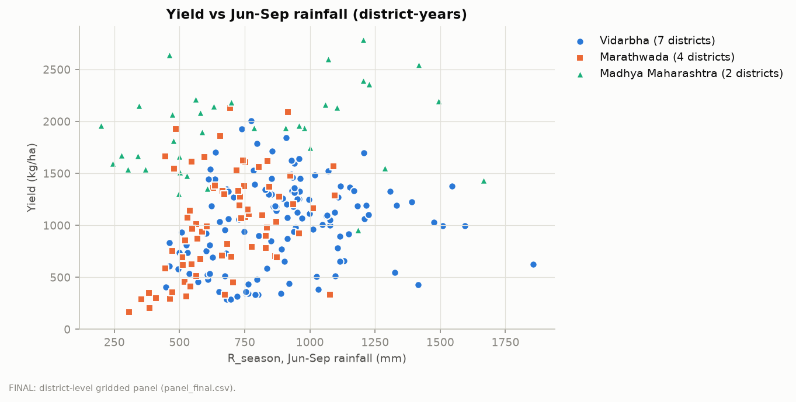

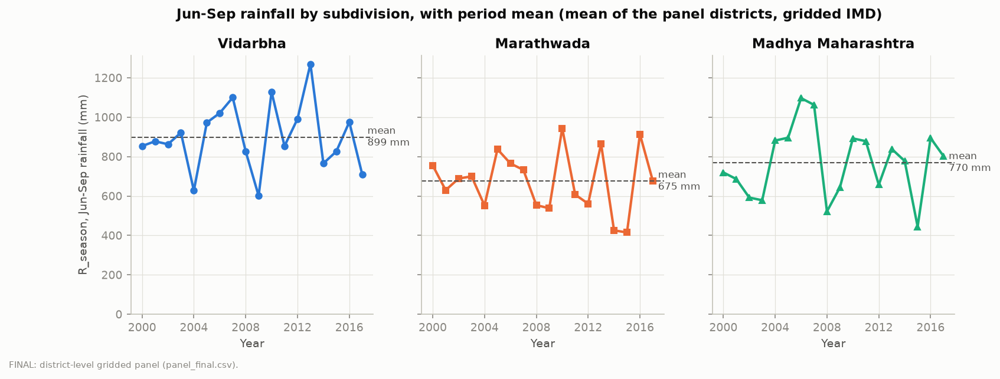

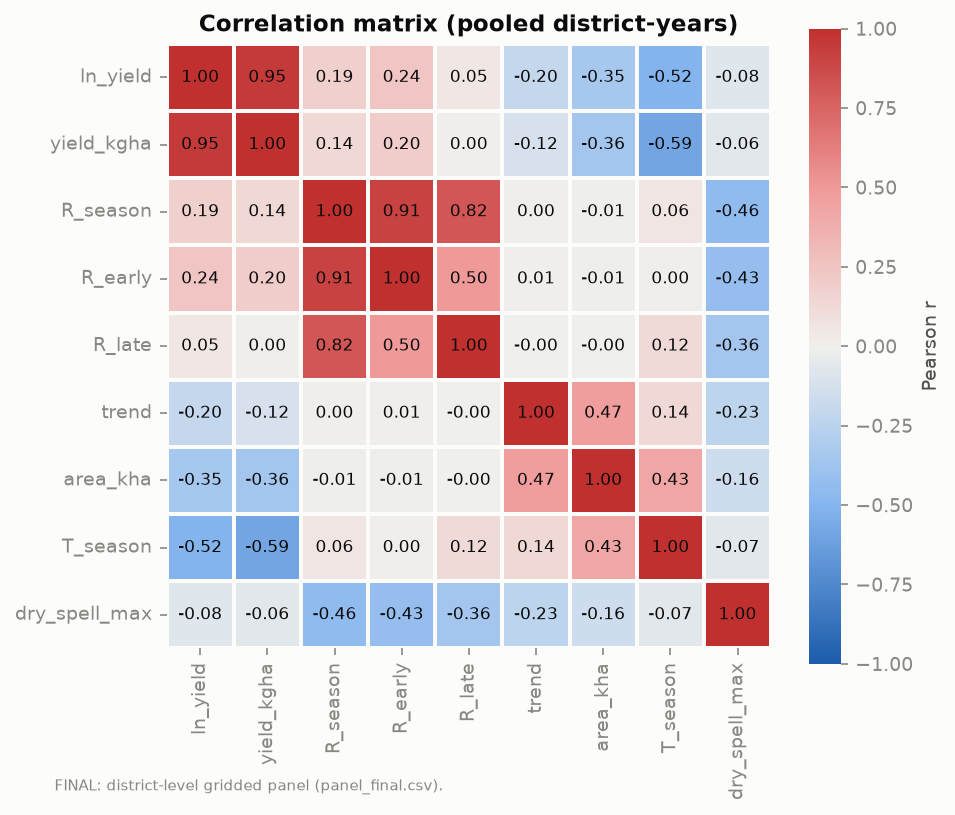

Rainfall and temperature are not strongly collinear: the pooled correlation is 0.06 and the within-district correlation is -0.49 (hotter seasons tend to be drier), with a maximum variance inflation factor of 1.58 in M2.

### 1.5 Model formulation

Both models use district fixed effects $\alpha_d$ and a common linear trend $\gamma t$.

**M1 (linear):**
$$\ln Y_{dt} = \alpha_d + \gamma\, t + \beta_1\, Rc_{dt} + \beta_2\, Tc_{dt} + \varepsilon_{dt}$$

**M2 (quadratic):**
$$\ln Y_{dt} = \alpha_d + \gamma\, t + \beta_1\, Rc_{dt} + \beta_3\, Rc_{dt}^2 + \beta_2\, Tc_{dt} + \beta_4\, Tc_{dt}^2 + \varepsilon_{dt}$$

| Parameter | Meaning |
|---|---|
| $\alpha_d$ | Permanent level of log yield in district $d$ (soil, typical practice, mean climate and anything else that does not change over time) |
| $\gamma$ | Common drift in log yield per year, net of weather; absorbs technology, prices and other slowly changing factors, and is not interpreted as a technology effect |
| $\beta_1$ (M1) | Change in log yield per additional 100 mm of season rainfall, temperature held fixed |
| $\beta_2$ (M1) | Change in log yield per additional 1 C of season temperature, rainfall held fixed |
| $\beta_1$, $\beta_2$ (M2) | Slopes at the panel mean of rainfall and temperature |
| $\beta_3$, $\beta_4$ (M2) | Curvature in the rainfall and temperature responses (negative = concave, i.e. diminishing returns and eventually decline) |

The $\beta_3$ and $\beta_4$ terms imply turning points at $Rc^* = -\beta_1/(2\beta_3)$ and $Tc^* = -\beta_2/(2\beta_4)$. Because the outcome is in logs, a coefficient of 0.01 is about a 1% change in yield. A third, exploratory timing model replaces seasonal rainfall with $R_{early}$, $R_{late}$ and dry_spell_max.

**100 mm experiment.** For district $d$ with mean rainfall $\bar R_d$ and mean temperature $\bar T_d$, the change in log yield is $\Delta_d = f(\bar R_d - 100) - f(\bar R_d)$, where $f$ is the fitted weather part of the model, and the percent change is $\exp(\Delta_d) - 1$. In M1 this is $\exp(-\beta_1) - 1$ for every district (because $Rc$ is in units of 100 mm). In M2 it depends on where the district sits on the rainfall curve. Variant A (the headline) holds temperature fixed at $\bar T_d$. Variant B (exploratory) lets temperature move with rainfall using each district's own within-district regression slope of temperature on rainfall. State and subdivision figures are unweighted means of the district results. kg/ha figures apply the percent change to each district's mean observed yield over the panel years.

### 1.6 Statistical and causal assumptions

**Statistical assumptions.**

1. *Functional form:* log yield is linear in the parameters, with rainfall and temperature entering linearly (M1) or quadratically (M2). Whether the quadratic is needed is tested, not assumed.
2. *Common slopes:* all 13 districts share the same weather coefficients; heterogeneity in the effect across districts arises only through the district's position on the fitted curve.
3. *Time-invariant district differences* are removed by fixed effects, and slow common drift is absorbed by the linear trend.
4. *Exogeneity:* after removing district effects and the trend, weather deviations are uncorrelated with the error term. Weather is not chosen by farmers, which makes this plausible for weather shocks, but see below.
5. *Dependence:* errors may be heteroskedastic, serially correlated within districts and correlated across districts within a year. We do not assume independence; inference uses methods that allow for these (Section 2.1). Section 4.1 shows this precaution is needed.
6. *Measurement:* district rainfall and temperature are area averages of gridded products, so they measure exposure with error. Random measurement error would typically bias weather coefficients towards zero. The temperature grid (1 degree) is coarse; the rainfall product is less reliable along the Western Ghats.
7. *Yield data:* ICRISAT yield equals production divided by area as reported; a zero area means the crop was not grown.

**Causal assumptions and limits.** Within-district weather variation is a natural source of variation that farmers do not control, so the coefficients are more credible as effects of weather shocks than a cross-section would be. We nevertheless report associations, for three reasons. First, other state-wide shocks that move with the monsoon (pests, input and output prices, policy, sowing-season conditions) cannot be separated from rainfall when most rainfall variation is common to all districts; the year-fixed-effects result in Section 4.3 shows how much this matters. Second, we have no controls for irrigation, inputs or sowing date. Third, the estimates reflect short-run responses to weather in the observed period and do not include longer-term adaptation (the same limitation Lobell et al., 2011, state), so they should not be read as forecasts of the effect of climate change.

---

## 2. Estimates of parameters

### 2.1 Estimation method

Models are estimated by the within estimator (ordinary least squares with district effects), using the `linearmodels` PanelOLS routine in Python and cross-checked against a separate array implementation used for the bootstrap. Because the residual diagnostics (Section 4.1) show serial correlation, heteroskedasticity and cross-district dependence, we report several inference methods side by side:

- district-clustered, year-clustered and two-way clustered standard errors;
- Driscoll-Kraay standard errors (Bartlett kernel, 2 lags), which are unreliable with 18 years and are flagged as such;
- a wild cluster bootstrap by district (with 13 districts, all 2^13 = 8192 sign patterns are enumerated, so the p-value is exact);
- a **moving-block bootstrap over years** with block length 3 (2000 replications; lengths 2 and 4 as sensitivity). Whole years are resampled in blocks of consecutive years, with all 13 districts of a year kept together, and the full model is refitted each time. This preserves dependence across districts within a year and short-run dependence across years, and it provides our headline 95% percentile intervals.

**Linear vs quadratic** is tested by the joint hypothesis that both squared terms are zero ($\beta_3 = \beta_4 = 0$) under each method. Before any final model was fitted we fixed the decision rule: if the squared terms are significant at the 5% level under *every* one of the main methods (district-clustered, wild bootstrap, year-clustered, two-way, Driscoll-Kraay, block bootstrap with L = 3), the quadratic is the headline model; if the conclusion differs across methods, the result is called inconclusive and the linear model is the headline, with the quadratic reported beside it.

Fit is summarised by within R-squared, AIC and BIC (from the Gaussian log-likelihood of the within model; lower is better) and by leave-one-year-out prediction error, converted to kg/ha with and without Duan's smearing correction.

### 2.2 Linear estimates (M1)

**Table 3. Coefficients (ln yield; per 100 mm and per 1 C; centred at the panel means).**

| Model | Term | Coef. | SE (district-CR) | p (district-CR) | SE (MBB L3) | 95% CI (MBB L3) | p (MBB L3) | p (year-CR) |
|---|---|---|---|---|---|---|---|---|
| M1 | trend | -0.01717 | 0.00583 | 0.0036 | 0.02214 | [-0.0663, 0.0277] | 0.2010 | 0.1244 |
| M1 | Rc | 0.06605 | 0.02139 | 0.0023 | 0.03701 | [-0.0131, 0.1276] | 0.0930 | 0.0541 |
| M1 | Tc | -0.19780 | 0.06081 | 0.0013 | 0.18550 | [-0.5339, 0.2310] | 0.3030 | 0.1803 |
| M2 | trend | -0.01475 | 0.00502 | 0.0037 | 0.02214 | [-0.0631, 0.0321] | 0.2570 | 0.1094 |
| M2 | Rc | 0.09578 | 0.01714 | 0.0000 | 0.03065 | [0.0328, 0.1549] | 0.0140 | 0.0036 |
| M2 | Rc_sq | -0.01115 | 0.00278 | 0.0001 | 0.00276 | [-0.0152, -0.0044] | 0.0000 | 0.0008 |
| M2 | Tc | -0.12492 | 0.08264 | 0.1321 | 0.18489 | [-0.4357, 0.3035] | 0.5680 | 0.3214 |
| M2 | Tc_sq | -0.11977 | 0.03408 | 0.0005 | 0.05956 | [-0.2398, -0.0082] | 0.0360 | 0.0603 |

CR = cluster-robust; MBB L3 = moving-block bootstrap with block length 3; a p-value shown as 0.0000 means below 0.0001.

In M1, the rainfall coefficient is 0.066: each additional 100 mm of seasonal rainfall is associated with about 6.6% higher yield. This is significant with district-clustered standard errors (p = 0.0023) but not at the 5% level with the block bootstrap (p = 0.093; interval from -0.013 to 0.128) or year-clustered errors (p = 0.054). The temperature coefficient is negative (-0.198 per C) but imprecise under year-based methods. The trend is negative (about -1.7% per year) and not statistically significant under year-based methods (Section 4.3).

### 2.3 Quadratic estimates (M2)

In M2 the rainfall slope at the panel mean is 0.096 per 100 mm and the squared term is -0.0111. Both are significant under every method in Table 3 (block-bootstrap intervals [0.033, 0.155] and [-0.0152, -0.0044]), so the rainfall response is concave: yield rises with rainfall at a decreasing rate. The implied rainfall turning point is **1,240 mm**; only 6.0% of the district-years lie above it, so the sample is almost entirely on the rising part of the curve (the nonlinearity here is mainly diminishing returns, not a demonstrated yield loss from excess rain).

The temperature slope at the panel mean is not significant (-0.125; block-bootstrap interval [-0.436, 0.304]), but the squared term is negative (-0.120) with a block-bootstrap interval that excludes zero ([-0.240, -0.008], p = 0.036). It is borderline under year-clustered (p = 0.060) and two-way clustered (p = 0.057) errors. The implied temperature turning point is 26.93 C, and 76.9% of district-years lie above it, so the fitted temperature effect is negative over most of the sample. We treat temperature as a control, not a headline finding, because the temperature grid is coarse and several districts share cells.

### 2.4 Linear vs quadratic comparison

**Table 4a. Joint test of $\beta_3 = \beta_4 = 0$ (p-values by method).**

| Method | p |
|---|---|
| District-clustered | < 0.0001 |
| Wild cluster bootstrap (district) | 0.0020 |
| Year-clustered | < 0.0001 |
| Two-way clustered | < 0.0001 |
| Driscoll-Kraay | < 0.0001 |
| Moving-block bootstrap (L = 3) | < 0.0001 |

By the pre-specified rule the verdict is **quadratic supported**, and M2 is the headline model. The same verdict holds for the model fitted to yield in kg/ha instead of log yield (the largest p-value across methods is 0.0203, from the wild bootstrap).

**Table 4b. Fit and leave-one-year-out prediction.**

| Model | Within R2 | AIC | BIC | RMSE (ln) | RMSE kg/ha (naive) | RMSE kg/ha (smeared) |
|---|---|---|---|---|---|---|
| M1 | 0.2040 | 301.24 | 356.53 | 0.4907 | 500.7 | 514.2 |
| M2 | 0.2876 | 279.28 | 341.48 | 0.4663 | 463.2 | 468.6 |
| Trend only | 0.0550 | 337.38 | 385.76 | 0.5101 | 478.9 | 478.9 |

M2 has lower AIC and BIC than M1, a higher within R-squared, and lower held-out error. In kg/ha, M2 beats the trend-only model (468.6 against 478.9 with smearing; 463.2 without), while M1 does not (514.2). The improvement is modest. Models fitted directly to yield in kg/ha give held-out errors of 441.3 (M1), 427.0 (M2) and 453.5 (trend only).

### 2.5 Goodness of fit and interpretation

The within R-squared of M2 is 0.288: weather and the trend together explain under a third of the year-to-year variation in yield within districts, against 0.055 for the trend alone. Most within-district variation therefore remains unexplained, which is expected given that irrigation, inputs, pests, prices, sowing date and within-season weather extremes are not modelled. The models are best read as describing how much of yield variation is *associated with* seasonal rainfall and temperature, not as a forecasting tool. The held-out comparison supports this: the gain over a trend-only model is small.

---

## 3. Numerical experiments

### 3.1 The 100 mm rainfall deficit

**Table 5. Scenario results, mean of the 13 districts (variant A: temperature fixed; B: temperature moves with rainfall; 95% moving-block bootstrap intervals).**

| Model | Scenario | Variant | Change (%) | 95% interval (%) | Change (kg/ha) | 95% interval (kg/ha) |
|---|---|---|---|---|---|---|
| **M2 (headline)** | **100 mm deficit** | **A** | **-10.04** | **[-15.18, -4.29]** | **-117.2** | **[-176.6, -50.7]** |
| M2 | 100 mm deficit | B | -11.80 | [-16.11, -6.41] | -132.2 | [-179.7, -70.0] |
| M1 | 100 mm deficit | A | -6.39 | [-11.98, +1.32] | -74.0 | [-138.7, +15.3] |
| M1 | 100 mm deficit | B | -8.80 | [-12.98, -2.98] | -101.1 | [-149.1, -33.6] |
| M2 | 100 mm surplus | A | +8.95 | [+2.23, +15.57] | +105.1 | [+27.7, +182.0] |
| M1 | 100 mm surplus | A | +6.83 | [-1.30, +13.61] | +79.1 | [-15.1, +157.6] |

kg/ha baseline = each district's mean observed yield over 2000-2017.

**The headline result.** Under M2 with temperature held at each district's mean, a 100 mm deficit in June-September rainfall is associated with an estimated yield reduction of **10.04% (95% interval 4.29% to 15.18%), or 117 kg/ha (51 to 177 kg/ha)**, averaged over the 13 districts. For scale, 100 mm is about 12% of the panel mean seasonal rainfall (810 mm) and about half of the within-district standard deviation of seasonal rainfall (188 mm). The interval stays below zero with block lengths 2 and 4 ([-14.85%, -3.86%] and [-14.99%, -5.05%]) and under a district bootstrap ([-12.71%, -6.72%]).

Allowing temperature to move with rainfall (variant B, exploratory) gives a somewhat larger loss (11.80%). The linear model gives a smaller effect (6.39%) whose interval includes zero. A rainfall-only quadratic variant (no temperature terms) gives 10.03% (interval -15.28% to -3.94%), almost identical to the headline, so the temperature terms hardly change the rainfall result. Together these show that the size of the effect depends on the specification, and the honest summary is that the association is negative and economically meaningful but not sharply estimated.

**By subdivision (M2, variant A):** Madhya Maharashtra -10.70% [-15.76%, -4.98%], Marathwada -12.80% [-17.90%, -7.46%], Vidarbha -8.28% [-13.54%, -2.23%].

**By district.** In M1 every district has the same percentage effect, because the model is linear in rainfall. In M2 the effect differs by district because districts sit at different points on the same pooled curve (Table 6); this is not a separate estimate for each district. Drier districts lose more per 100 mm (Sangli, mean 438 mm, loses 17.30%) and the wettest, Chandrapur (mean 1247 mm, close to the 1,240 mm turning point), shows about 1% with an interval spanning zero. Because Sangli's yields are high, its loss in kg/ha (312) is the largest.

**Table 6. 100 mm deficit by district, M2, variant A (95% MBB intervals).**

| District | Mean rainfall (mm) | Mean temp. (C) | Change (%) | 95% interval (%) | Change (kg/ha) |
|---|---|---|---|---|---|
| Akola | 752 | 27.73 | -11.30 | [-16.36, -5.67] | -121.8 |
| Amarawati | 823 | 27.61 | -9.88 | [-15.03, -4.15] | -100.2 |
| Beed | 595 | 27.07 | -14.35 | [-19.49, -8.93] | -137.1 |
| Buldhana | 698 | 27.67 | -12.36 | [-17.38, -6.92] | -146.4 |
| Chandrapur | 1247 | 28.22 | -0.96 | [-7.97, +7.47] | -9.0 |
| Kolhapur | 1102 | 25.97 | -4.10 | [-9.97, +3.14] | -83.8 |
| Nagpur | 992 | 27.60 | -6.42 | [-11.84, -0.01] | -59.1 |
| Nanded | 773 | 27.88 | -10.89 | [-15.96, -5.13] | -104.6 |
| Osmanabad | 618 | 27.24 | -13.91 | [-19.04, -8.53] | -145.8 |
| Parbhani | 715 | 27.67 | -12.03 | [-17.04, -6.54] | -134.7 |
| Sangli | 438 | 25.69 | -17.30 | [-22.72, -11.16] | -311.7 |
| Wardha | 897 | 28.20 | -8.40 | [-13.65, -2.40] | -84.5 |
| Yeotmal | 884 | 28.27 | -8.66 | [-13.90, -2.72] | -85.0 |

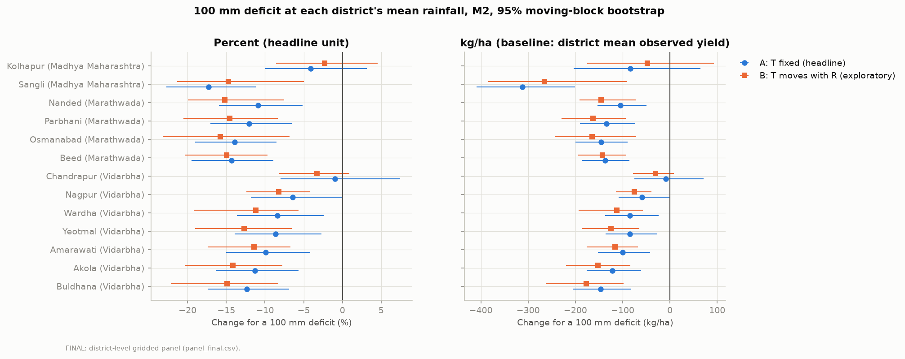

### 3.2 Weak-monsoon scenarios

We also evaluated seasons in which rainfall is 90% and 80% of each district's mean. These are illustrative scenarios, not forecasts.

**Table 7. Weak-monsoon scenarios (mean of 13 districts).**

| Model | Rainfall level | Variant | Change (%) | 95% interval (%) | Change (kg/ha) |
|---|---|---|---|---|---|
| M2 | 90% of mean | A | -7.27 | [-11.62, -2.39] | -83.0 |
| M2 | 90% of mean | B | -8.77 | [-12.09, -4.71] | -95.9 |
| M2 | 80% of mean | A | -15.32 | [-23.06, -6.16] | -175.3 |
| M2 | 80% of mean | B | -18.22 | [-24.56, -10.10] | -200.6 |
| M1 | 90% of mean | A | -5.20 | [-9.79, +1.07] | -59.9 |
| M1 | 80% of mean | A | -10.12 | [-18.57, +2.15] | -116.5 |

Losses grow faster than proportionally under M2 as the deficit deepens (about 7.3% at a 10% deficit and 15.3% at a 20% deficit), which is what the concave response implies. Under the linear model the intervals at both levels include zero (variant A). We also explored a timing version of the 100 mm deficit, split between June-July and August-September in proportion to each window's share of mean seasonal rainfall; it gives -5.75% with an interval that includes zero ([-11.61%, +1.74%]). The timing model is exploratory, and with these data we cannot establish that timing within the season adds reliable information beyond the seasonal total.

### 3.3 Response curves and behaviour under changes in rainfall and temperature

The fitted M2 behaves sensibly across the observed range:

- **Rainfall:** the response is increasing and concave, with a maximum at 1,240 mm. 94.0% of district-years lie below this value, so predictions are well supported at low and moderate rainfall and weakly supported near and above the turning point. The deficit experiments use rainfall values inside the observed range.
- **Asymmetry:** a 100 mm *surplus* raises yield by 8.95% under M2, less in magnitude than the 10.04% loss from the same deficit (ratio 0.89), as expected under a concave response. Under M1 the log link gives a ratio of 1.07 (6.83% against 6.39%).
- **Temperature:** the fitted response peaks at 26.93 C, and since 76.9% of district-years are above it, warmer seasons are associated with lower yield over most of the sample, but the temperature slope is imprecise.

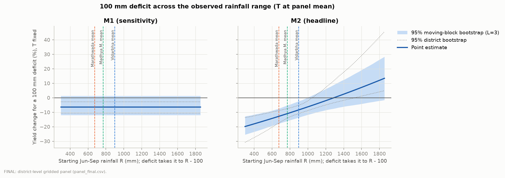

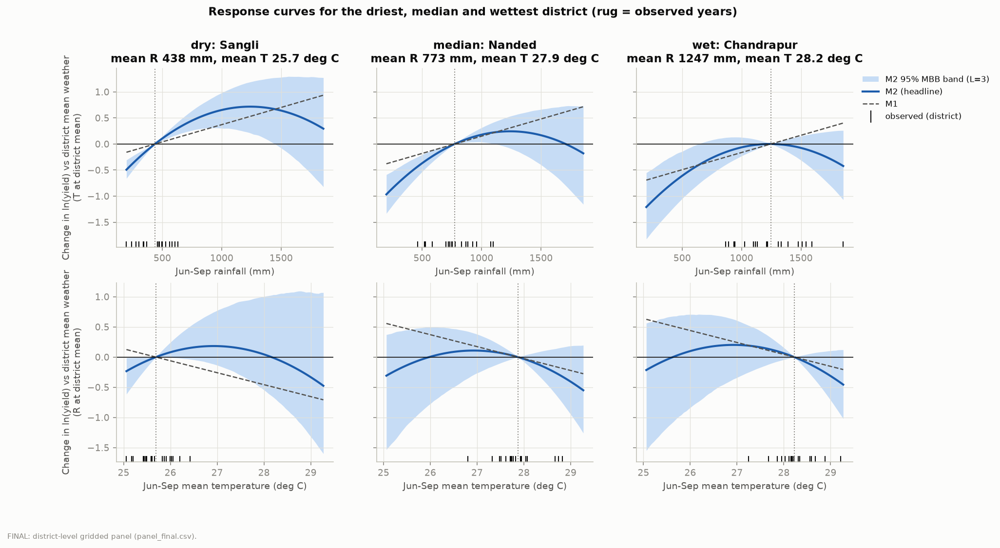

As an arithmetic check, the headline was recomputed independently from the stored M2 coefficients; it matched the main scenario code to machine precision.

---

## 4. Stability analysis

### 4.1 Residual diagnostics and model validation

**Table 8. Residual diagnostics.**

| Model | Test | Statistic | p |
|---|---|---|---|
| M1 | Breusch-Pagan (squared residuals on trend and weather) | 12.560 | 0.0057 |
| M1 | Brown-Forsythe, equal variance across districts | 1.540 | 0.1115 |
| M1 | Brown-Forsythe, equal variance across years | 3.033 | 0.0001 |
| M1 | Jarque-Bera normality | 19.101 | 0.0001 |
| M1 | Wooldridge serial correlation (H0: none) | 18.954 | 0.0009 |
| M1 | Pesaran cross-sectional dependence (H0: none) | 13.489 | < 0.0001 |
| M2 | Breusch-Pagan | 17.741 | 0.0033 |
| M2 | Brown-Forsythe, across districts | 1.360 | 0.1869 |
| M2 | Brown-Forsythe, across years | 2.631 | 0.0007 |
| M2 | Jarque-Bera normality | 21.604 | < 0.0001 |
| M2 | Wooldridge serial correlation | 15.660 | 0.0019 |
| M2 | Pesaran cross-sectional dependence | 12.543 | < 0.0001 |

The residuals of both models show:

- **Heteroskedasticity:** variance depends on the regressors (Breusch-Pagan) and differs across years, but not detectably across districts.
- **Non-normality** (Jarque-Bera), so exact small-sample normal-theory p-values are not reliable.
- **Serial correlation** within districts (the within-residual AR(1) correlation is 0.19 for M2).
- **Strong cross-district dependence** (Pesaran statistic 12.5): districts are hit by common shocks in the same year, consistent with the 2.56 effective independent rainfall signals.

These findings are why the model's standard errors are not taken from the classical formulas and why headline intervals use the block bootstrap over years. They also show the model is an incomplete description of the data: common year-level shocks remain in the residuals (Figure 12). Within-district correlation of rainfall and temperature is -0.49, and the maximum variance inflation factor is 1.58, so collinearity does not undermine the estimates.

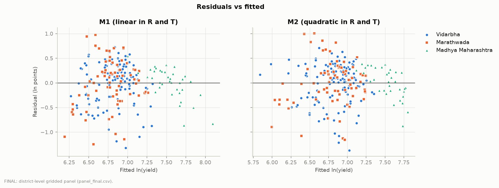

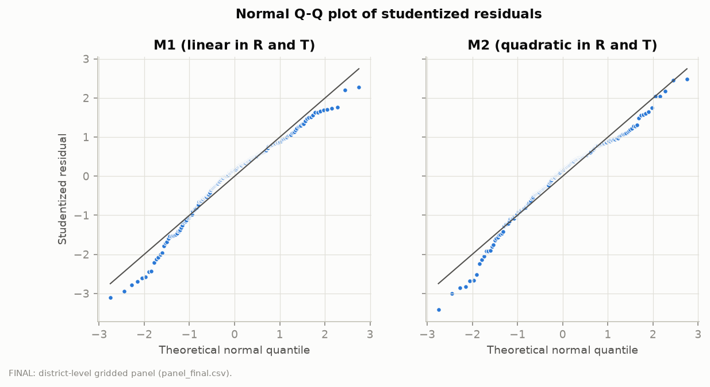

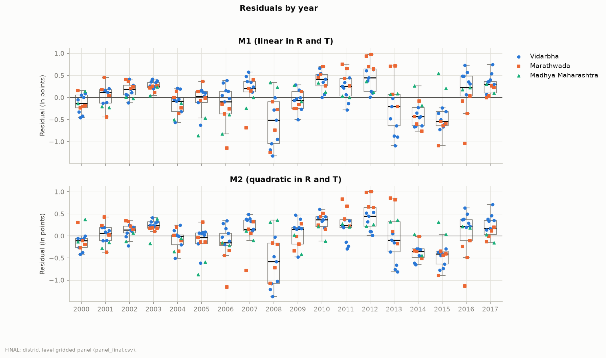

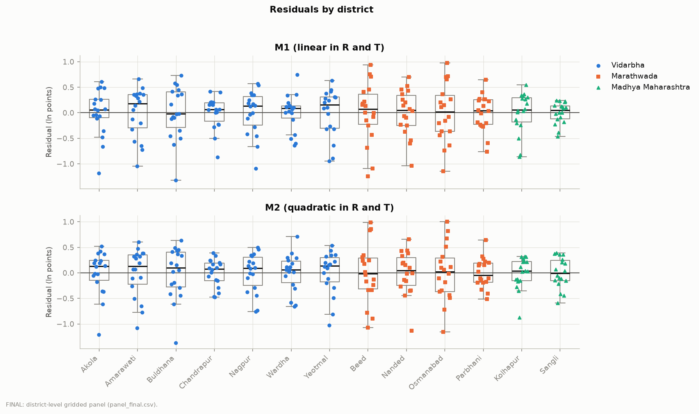

### 4.2 Leave-one-out stability

Dropping each district in turn moves the 100 mm effect only between -11.60% and -9.41% in M2 (headline -10.04%) and between -8.15% and -5.45% in M1 (headline -6.39%), so no single district drives the result (Figure 16). Dropping each of the drought years 2009, 2014 and 2015 gives M2 effects of -10.71%, -9.63% and -9.28%. The headline interval is also robust to the bootstrap block length (L = 2, 3, 4) and to resampling districts instead of years (Section 3.1).

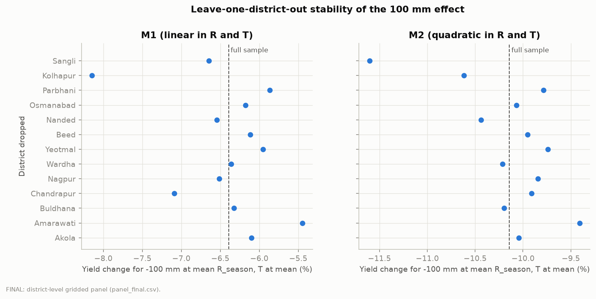

### 4.3 Robustness (windows, weighting, standard errors, boundary variants)

**Table 9. Robustness of the 100 mm deficit effect (temperature fixed, mean over districts).**

| Variant | n | M1 | M2 | Interval method |
|---|---|---|---|---|
| Base | 234 | -6.39% [-12.65, -0.13] | -10.04% [-15.94, -4.14] | delta (year-clustered) |
| Drop Kolhapur and Sangli | 198 | -8.51% [-15.91, +0.49] | -11.81% [-18.45, -5.43] | MBB L3 |
| Drop 2000-2003 | 182 | -6.43% [-13.83, +0.96] | -10.01% [-17.14, -2.89] | delta |
| Drop flagged district-years | 231 | -6.48% [-12.81, -0.16] | -10.33% [-16.24, -4.41] | delta |
| Drop boundary-sensitive districts (Akola, Parbhani, Osmanabad, Chandrapur) | 162 | -5.80% [-11.82, +0.23] | -9.38% [-15.09, -3.67] | delta |
| Wider 17-district set | 306 | -4.11% [-8.88, +0.66] | -8.54% [-13.09, -3.99] | delta |
| Area-weighted | 234 | -8.03% [-15.45, +1.52] | -10.97% [-17.81, -4.14] | MBB L3 |
| Drop district-years with area < 20 kha | 228 | -6.31% [-12.66, +0.03] | -9.98% [-15.95, -4.01] | delta |
| No trend | 234 | -5.60% [-12.07, +0.87] | -9.50% [-15.35, -3.65] | delta |
| District-specific trends | 234 | -6.38% [-12.91, +0.15] | -9.87% [-16.18, -3.56] | delta |
| Window Jul-Sep | 234 | -6.84% [-12.45, -1.23] | -9.33% [-15.58, -3.09] | delta |
| Window Jun-Jul | 234 | -9.39% [-19.73, +0.94] | -19.01% [-25.97, -12.05] | delta |
| Drop 2009 | 221 | -6.33% [-12.81, +0.16] | -10.71% [-16.59, -4.82] | delta |
| Drop 2014 | 221 | -5.99% [-11.83, -0.15] | -9.63% [-15.22, -4.04] | delta |
| Drop 2015 | 221 | -6.15% [-12.23, -0.07] | -9.28% [-15.00, -3.56] | delta |
| **Year fixed effects** | 234 | **+2.09% [-3.32, +7.73]** | **-3.20% [-8.39, +0.64]** | MBB L3 |

"Delta" = delta method with year-clustered covariance; "MBB L3" = moving-block bootstrap over years, block length 3, 2000 replications. Intervals are 95%. The Jun-Jul and Jul-Sep rows apply the same 100 mm to a shorter window, so they are not directly comparable with the other rows.

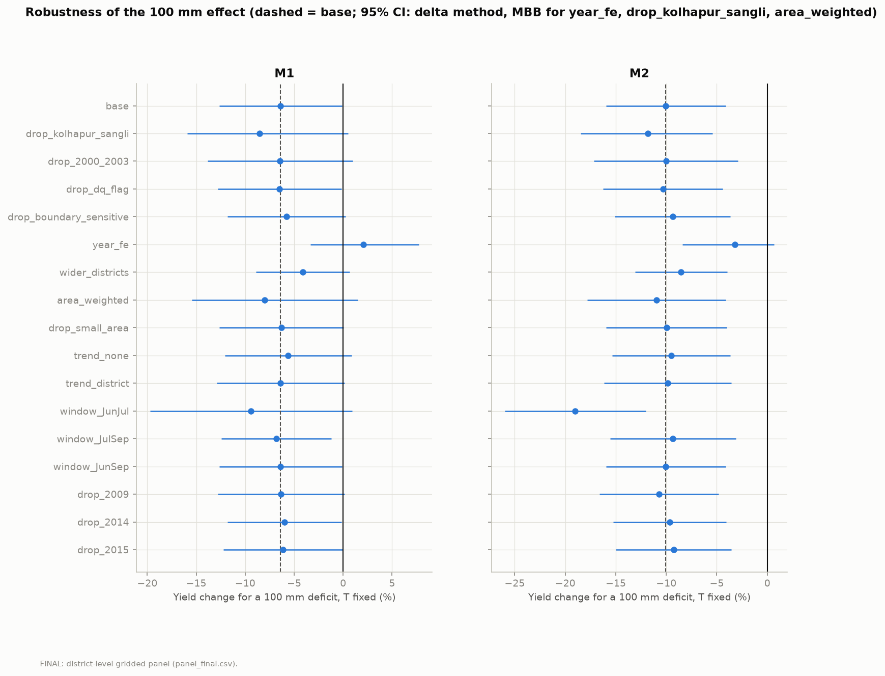

**Reading the table.**

- **Across the core variants** (dropping rows or districts, area weighting, trend choices, wider set, boundary variants, dropping drought years), the M2 effect lies between **-11.81% and -8.54%**, and the M1 effect between -8.51% and -4.11%. Every M2 interval in these rows excludes zero; several M1 intervals include it.
- **Western Ghats districts:** dropping Kolhapur and Sangli, the districts in the zone where the gridded rainfall is least reliable, makes the M2 effect slightly larger (-11.81%).
- **Area weighting:** weighting by area moves M1 from -6.39% to -8.03% and M2 to -10.97%. For M1, decomposing the weights into a between-district part and a within-district (over time) part gives -8.48% and -6.13% respectively, so most of the shift comes from how districts are weighted, not from the time profile.
- **Window:** a shorter Jun-Jul window gives a larger M2 effect (-19.01%), as expected when 100 mm is a larger share of the window's rainfall.
- **Trend:** the trend coefficient is negative and not significant. With 2016-2017 included, it is -1.46% per year in M2 (p = 0.109, year-clustered) compared with -2.32% per year over 2000-2015 (p = 0.085). We do not interpret it, because it reflects the poor 2014-2015 seasons and other slow changes that the model does not separate.
- **Year fixed effects (the key caveat):** adding year effects reduces the M2 effect to -3.20% (interval -8.39% to +0.64%) and the M1 effect to +2.09%. Year dummies explain 56.2% of the within-district variation in rainfall (and 88.3% of that in temperature), so most of the rainfall variation used in the headline estimate is *common to all districts in a year*. The year-effects model keeps only variation between districts within the same year, which is far smaller and about which these data say little. The headline therefore describes the association between yield and state-wide monsoon strength. It cannot be distinguished from other state-wide shocks that moved in the same years, and it should not be read as the effect of a district's own rainfall relative to its neighbours.

**Summary of sensitivity.** The sign of the rainfall association is stable across specifications that do not remove year-level variation. Its size depends on three choices: linear versus quadratic (-6.4% against -10.0%), whether temperature moves with rainfall (-10.0% against -11.8%), and whether year effects are included (-3.2%).

---

## 5. Conclusion

**Answer to the research question.** In a balanced panel of 13 Maharashtra districts over 2000-2017, soybean yield rises with June-September rainfall at a diminishing rate. A quadratic model in rainfall and temperature is preferred to a linear one: the squared terms are significant under all six pre-specified inference methods, the model has lower AIC and BIC, and it predicts held-out years better, although the improvement in prediction is modest. Under this model, with temperature held at each district's mean, **a 100 mm rainfall deficit during June-September is associated with an estimated yield reduction of 10.0% (95% interval 4.3% to 15.2%), about 117 kg/ha (51 to 177 kg/ha), averaged over the 13 districts.** Across the core robustness variants the quadratic estimate ranges from 8.5% to 11.8%. A weak monsoon with rainfall at 90% and 80% of normal is associated with losses of 7.3% and 15.3% respectively.

**What the evidence supports and does not support.**

- The relationship is nonlinear and concave. Because 94% of district-years lie below the fitted rainfall turning point of 1,240 mm, the nonlinearity here mostly reflects diminishing returns; these data cannot show how large yield losses from excess rainfall would be.
- The effect is not uniform: it is larger in drier districts and smaller in wetter ones, but this follows from one pooled curve and is not a separate estimate for each district.
- Temperature terms are imprecise, and the temperature data are coarse; they act as a control.
- Timing within the season (early against late rainfall, dry spells) does not add reliable information in this study; the exploratory timing scenario is inconclusive.
- The estimates are **associations**. Rainfall is largely common across districts (2.56 effective independent signals); with year fixed effects the estimated effect falls to 3.2% with an interval including zero. The headline therefore reflects state-wide monsoon variation and cannot be separated from other state-wide shocks. It also excludes long-run adaptation and is not a forecast of climate-change impacts.

**Limitations.**

1. Short window (18 years) and only about 2.6 independent rainfall signals, so intervals are wide and sensitive to inference choices; the linear model's interval includes zero.
2. Rainfall in the Western Ghats zone is less reliable in the IMD gridded product; temperature is on a 1 degree grid shared by several districts.
3. No controls for irrigation, inputs, prices, pests or sowing date; the model explains under a third of within-district variation (within R-squared 0.288).
4. District boundaries are reconciled with a crosswalk; Partur taluka stays with Aurangabad (via Jalna), and most district-history links were taken from official pages compiled during the project and not independently re-verified (the Akola-Washim link was checked against two official sources).
5. Residuals show heteroskedasticity, serial and cross-district dependence and non-normality; we handle this with block-bootstrap intervals, but the diagnostics show the model leaves common yearly shocks unexplained.
6. The trend coefficient is negative and not significant, and is not interpreted.

**Possible extensions.** Finer temperature data and daily heat-exposure measures, district-level irrigated area and input data as controls, longer panels from other sources, and rainfall intensity and dry-spell measures, which Maiti et al. (2026) find matter for yields.

---

## References

Auffhammer, M., Ramanathan, V., & Vincent, J. R. (2012). Climate change, the monsoon, and rice yield in India. *Climatic Change*, 111(2), 411-424. https://doi.org/10.1007/s10584-011-0208-4

Goswami, B. N., Venugopal, V., Sengupta, D., Madhusoodanan, M. S., & Xavier, P. K. (2006). Increasing trend of extreme rain events over India in a warming environment. *Science*, 314(5804), 1442-1445. https://doi.org/10.1126/science.1132027

Lobell, D. B., & Field, C. B. (2007). Global scale climate-crop yield relationships and the impacts of recent warming. *Environmental Research Letters*, 2(1), 014002. https://doi.org/10.1088/1748-9326/2/1/014002

Lobell, D. B., Schlenker, W., & Costa-Roberts, J. (2011). Climate trends and global crop production since 1980. *Science*, 333(6042), 616-620. https://doi.org/10.1126/science.1204531

Maiti, A., et al. (2026). Excess rainfall threatens monsoon crop yield stability under climate change. *Earth's Future*, 14(6), e2025EF007801. https://doi.org/10.1029/2025EF007801

Maiti, A., Hasan, M. K., Sannigrahi, S., Bar, S., Chakraborti, S., Mahto, S. S., Chatterjee, S., Pramanik, S., Pilla, F., Auerbach, J., Sonnentag, O., Song, C., & Zhang, Q. (2024). Optimal rainfall threshold for monsoon rice production in India varies across space and time. *Communications Earth & Environment*, 5, 302. https://doi.org/10.1038/s43247-024-01414-7

Muñoz-Sabater, J., Dutra, E., Agusti-Panareda, A., et al. (2021). ERA5-Land: a state-of-the-art global reanalysis dataset for land applications. *Earth System Science Data*, 13(9), 4349-4383. https://doi.org/10.5194/essd-13-4349-2021 (considered as a temperature source; a single-point extract was rejected and not used.)

Pai, D. S., Rajeevan, M., Sreejith, O. P., Mukhopadhyay, B., & Satbha, N. S. (2014). Development of a new high spatial resolution (0.25 x 0.25 degree) long period (1901-2010) daily gridded rainfall data set over India and its comparison with existing data sets over the region. *MAUSAM*, 65(1), 1-18. https://doi.org/10.54302/mausam.v65i1.851

Patil, A., & Shende, N. (2022). Impact of climate change on productivity of soybean in Akola district of Maharashtra. *Journal of Food Legumes*, 35(4), 267-273. https://doi.org/10.59797/journaloffoodlegumes.v35i4.315

Schlenker, W., & Roberts, M. J. (2009). Nonlinear temperature effects indicate severe damages to U.S. crop yields under climate change. *Proceedings of the National Academy of Sciences*, 106(37), 15594-15598. https://doi.org/10.1073/pnas.0906865106

**Data and software.** ICRISAT District Level Database, Maharashtra extract (yield, area, production; 2000-2017). India Meteorological Department gridded daily rainfall, maximum and minimum temperature, downloaded 19 October 2026 via `imdlib` 0.3.1. District boundaries: DataMeet maps repository, 2011 Census districts (commit b3fbbde595310b397a55d718e0958ce249a4fa1f; CC BY 2.5 India). Analysis in Python (`pandas`, `numpy`, `statsmodels`, `linearmodels`, `geopandas`, `xarray`); exact versions in `requirements.txt`.

---

## Appendix

### A. Variable dictionary

| Variable | Unit | Definition | Source |
|---|---|---|---|
| yield_kgha | kg/ha | Soybean yield | ICRISAT |
| ln_yield | log kg/ha | Natural log of yield | derived |
| area_kha | 1000 ha | Soybean area | ICRISAT |
| R_season | mm | Sum of daily district-mean rainfall, 1 Jun-30 Sep | IMD 0.25 degree grid |
| R_early, R_late | mm | 1 Jun-31 Jul and 1 Aug-30 Sep rainfall | IMD |
| R_julsep | mm | 1 Jul-30 Sep rainfall (robustness window) | IMD |
| T_season | C | Season mean of daily (Tmax + Tmin)/2 | IMD 1 degree grid |
| dry_spell_max | days | Longest run of days below 2.5 mm, 1 Jun-30 Sep | IMD |
| trend | years | Year minus 2000 | derived |
| Rc, Tc | 100 mm; C | Season rainfall and temperature minus panel means (rainfall in units of 100 mm) | derived |
| dq_flag | 0/1 | 1 if |robust z| of R_season within district exceeds 3 | derived |

### B. District crosswalk (panel districts)

| ICRISAT (old) district | Current (2011) districts merged | Date of split | Status |
|---|---|---|---|
| Akola | Akola + Washim | 1 July 1998 | Checked against two official sources |
| Parbhani | Parbhani + Hingoli | 1 May 1999 | Official district-history page, not re-verified |
| Osmanabad | Osmanabad + Latur | 15 Aug 1982 | Official district-history page, not re-verified |
| Chandrapur | Chandrapur + Gadchiroli | 26 Aug 1982 | Official district-history page, not re-verified |
| Amarawati, Beed, Buldhana, Kolhapur, Nagpur, Nanded, Sangli, Wardha, Yeotmal | Same district | | Name matching only |

Known limitation: Partur taluka (from Parbhani) was moved to Jalna in 1981; Jalna is kept wholly in Aurangabad, so old Parbhani lacks Partur.

### C. Reproducibility

The full pipeline runs from the raw files with `bash run_all.sh` (a flag skips the 507 MB of weather downloads if they are already present). As a test, `data/processed` and `outputs/final` were deleted and rebuilt in about 28 seconds; all 60 CSV tables, all 21 figures and both generated summary documents were identical (byte for byte, apart from timestamps). Every number in this report is taken from the tables in `outputs/final`, and the generated files `docs/RESULTS_SUMMARY.md` and `docs/REPORT_INPUTS.md` list each figure with its source table. Raw data are never edited; all steps are logged in `docs/PROGRESS.md` and `docs/notes.md`.

### D. Decisions fixed before the final results

The specification of record (`docs/SPEC.md`) was written before any model was fitted and amended only with dated entries. The following were fixed before the final models were run and were not changed afterwards: the choice of soybean and the district rule (13 districts); log yield as the outcome with district effects and a common linear trend; the headline model set (M1 and M2 including temperature); the decision rule for choosing between the linear and quadratic model (significant under every main inference method); the inference methods (block bootstrap with L = 3 as the headline interval); the definition of the data-quality flag; the 100 mm and 90% and 80% scenarios; and the list of robustness runs. One result of the screening rule did not match its purpose (it flagged Buldhana wet years and not the Ghats districts); it was kept as written, and the Ghats concern was handled by the separate run dropping Kolhapur and Sangli.
